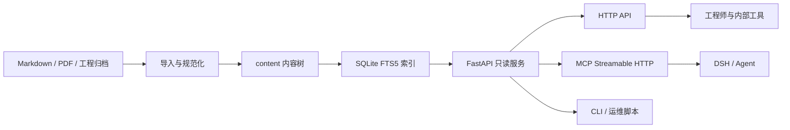

# OWKB — 面向嵌入式研发的只读知识库

> **OWKB（Onlywell Knowledge Base）** 是一个面向 MCU / 嵌入式研发团队的内部知识库：
> 把芯片手册、协议写法、历史项目案例和可复用源码整理成可检索、可引用的知识，
> 通过 HTTP API 与 MCP 提供给工程 agent 和工程师查阅。

> **这是公开的架构、设计与核心引擎代码展示仓库，包含一个可运行的最小 demo。**
> 原始芯片手册、客户工程源码、项目资料、token、证书、服务器配置均不在本仓库中。
> 具体范围见 [NOTICE.md](NOTICE.md)。

---

## 1. 为什么需要 OWKB

嵌入式研发的知识通常散落在这些地方：

- 芯片手册是 PDF，寄存器/页锚点难引用；
- 协议写法只存在于某位工程师的聊天记录或旧工程里；
- 历史项目的目录结构、配置字、踩坑结论没有统一归档；
- 同一个问题在新项目里反复重新查、重新猜；
- 通用代码搜索工具不理解“手册页 + 项目案例 + 源码镜像”的关系。

OWKB 的目标不是做一个通用网盘，而是给研发 agent 提供一份
**可追溯、只读、按工程语义组织**的参考知识。

---

## 2. 核心能力

| 能力 | 说明 |
|---|---|
| Markdown 知识正文 | 文档采用 frontmatter + Markdown，按集合和项目组织 |
| 手册页锚点 | 芯片手册保留 `<!-- pdf-page: N -->`，检索结果可回到原始页 |
| 图表快照 | 手册页内的表格/框图导出为相对路径图片，和正文一起归档 |
| SQLite FTS5 检索 | 全文索引 + 标题/标签/路径权重，支持中英文关键词 |
| 文档与源码统一检索 | 手册、写法、项目案例、代码镜像可以在同一索引中查询 |
| MCP / HTTP 接口 | agent 可通过 MCP 工具或只读 HTTP API 查询 |
| CLI 运维 | 导入、重建索引、移动/删除、体检、评测、备份 |
| 自动索引 | 内容变化后重建索引并形成可追溯的 Git 提交 |
| 溯源 | 文档记录 source、source_code、更新时间；源码镜像保持逐字副本 |

---

## 3. 核心代码与最小 demo

本仓库不只是设计文档，还包含 OWKB 的核心 Python 引擎和一个脱敏示例知识库。
核心代码位于 `app/`，可以直接阅读，也可以在本地跑索引/CLI：

```text
app/
  config.py           配置与路径
  frontmatter.py      YAML frontmatter 解析
  store.py            文档/目录/元数据
  index.py            SQLite FTS5 索引构建
  importer.py         Markdown 导入
  cli.py              CLI 入口
  server.py           FastAPI 服务
  mcp_tools.py        MCP 工具适配
  tokens.py           只读 token 管理
  uploads.py          受控上传隔离区
  upload_security.py  上传安全扫描
  autoindex.py        内容变化检测
```

`config/kb.yaml` 是本地示例配置；`content/示例/` 是一篇脱敏文档；
`requirements.txt` 和 `kb.cmd` 用于启动最小 demo。

### 最小运行

```powershell
py -3.12 -m pip install -r requirements.txt
.\kb.cmd reindex
.\kb.cmd status
.\kb.cmd check
```

需要 HTTP/MCP 服务时：

```powershell
py -3.12 -m app.server
```

公开 demo 只包含最小配置；生产用的 mTLS、token 绑定、上传审核和通知不在公开数据中。
内部数据准备脚本 `app/bootstrap.py` 属于私有工具，未包含在本仓库。

---

## 4. 架构



设计原则：

1. **content 是源，索引是可重建的派生数据。**
2. **知识只读。** agent 只能查询，写入由管理员通过受控导入流程完成。
3. **可追溯。** 文档有 source、更新时间、正文页锚点和 Git 历史。
4. **内容与代码分离。** 手册正文、图片快照和源码镜像各有明确目录约定。
5. **人能读，agent 也能读。** 不引入只有某个工具才能解析的私有格式。

更细的组件说明见 [docs/architecture.md](docs/architecture.md)。

---

## 5. 知识模型

OWKB 把内容分为几类：

| 类型 | 典型内容 | 组织方式 |
|---|---|---|
| 芯片手册 | MCU、传感器、外设规格书 | 每本一个 `full.md` + `snapshots/` |
| 写法 | RCC、RF、传感器、协议实现经验 | 按主题集合组织，带证据与示例 |
| 项目案例 | 真实产品工程的架构、配置、风险和验证 | 每个项目一个目录 |
| 代码库 | 经批准的历史项目源码镜像 | 按项目分目录，只读快照 |

文档使用 YAML frontmatter 描述 id、标题、集合、标签、状态、来源等元数据。
更完整的约定见 [docs/knowledge-model.md](docs/knowledge-model.md)。

---

## 6. Agent 如何用

```text
用户问题
  → agent 判断是否属于内部知识范畴
  → 调用 OWKB 检索工具
  → 得到带文档标题/路径/页锚点/行号的片段
  → 必要时继续读取同一文档的上下文
  → 在回答中引用具体文档位置
```

MCP 接口是只读的，主要提供：

- 全文检索；
- 按路径/ID 读取文档；
- 列出内容树与文档元数据；
- 读取手册页锚点和图片资源。

设计细节见 [docs/agent-integration.md](docs/agent-integration.md)。

---

## 7. 内容治理

导入不是简单地把文件丢进目录：

1. 确认来源与授权；
2. 规范化 Markdown/PDF 产物；
3. 检查页锚点、图片引用、表格完整性；
4. 检查重复内容、孤儿文档、敏感文件；
5. 加入明确的 collection/tags/source；
6. 重建索引并提交 Git。

治理流程、检查项和回滚方式见 [docs/content-governance.md](docs/content-governance.md)。

---

## 8. 当前状态

截至 2026-11-26，内部生产实例的规模约为：

```text
docs   792
chunks 5321
```

这些数字只是规模参考；本展示仓库**不包含**对应的生产数据。

---

## 9. 本仓库包含什么

```text
README.md                         项目总览
NOTICE.md                         公开范围与使用边界
requirements.txt                   Python 依赖
kb.cmd                             CLI 包装
app/                               核心 Python 引擎
config/kb.yaml                     本地示例配置
content/示例/                      脱敏示例知识库
docs/
  architecture.md                 组件与数据流
  knowledge-model.md              文档/手册/代码模型
  agent-integration.md            MCP/HTTP 只读接口设计
  content-governance.md           导入、审核、索引与回滚
  roadmap.md                      演进方向
examples/
  sample-document.md              脱敏的文档格式示例
assets/
  example-block.png               示例图片
```

**不包含：**

- 芯片厂商手册原文、PDF、图片；
- 公司/客户工程源码；
- 项目案例中的产品资料；
- token、证书、密钥、服务器地址与运维凭据；
- 生产数据库、索引文件、日志与备份；
- 内部数据准备脚本 `app/bootstrap.py` 及生产导入配置。

---

## 10. 适合谁看

- 想了解“研发知识库 + agent 检索”如何设计的工程师；
- 需要给内部手册/历史工程建立可检索索引的团队；
- 正在做 MCP 工具、代码检索、文档治理的开发者；
- 想参考只读知识库安全边界和导入流程的维护者。

---

## 11. 相关文档

- [架构与组件](docs/architecture.md)
- [知识模型](docs/knowledge-model.md)
- [Agent 集成](docs/agent-integration.md)
- [内容治理](docs/content-governance.md)
- [路线图](docs/roadmap.md)
- [公开范围与使用边界](NOTICE.md)

---

## 12. 说明

OWKB 最初是为内部研发协作而建，本仓库只抽取了可公开的架构与设计经验。
如果你对某个设计点感兴趣，欢迎通过 issue 讨论；请不要在本仓库提交内部资料或凭据。
