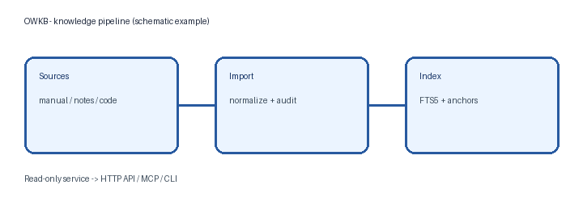

# 示例：带页锚点的文档

> 这是公开仓库中的脱敏示例，不对应任何真实芯片、产品或客户项目。

<!-- pdf-page: 12 -->

## 1. 一个可检索的小节

OWKB 的检索块由 Markdown 标题、正文和页锚点共同定位。
下面的表格只是格式示例：

| 位 | 名称 | 说明 |
|---|---|---|
| 7 | EN | 功能使能 |
| 6:4 | PS | 预分频选择 |
| 3:0 | CLK | 时钟源选择 |

```text
复位值：0x00
```

## 2. 图文混排

图片使用相对路径，和文档一起归档：



## 3. 检索关键词

这段文字包含几个便于演示检索的合成关键词：

```text
example-sensor
pipeline-anchor
field-note
```

## 4. 说明

- 文档 id 稳定；
- 标题和路径参与检索；
- `pdf-page` 锚点用于回到原始页；
- 图片路径必须可解析。
