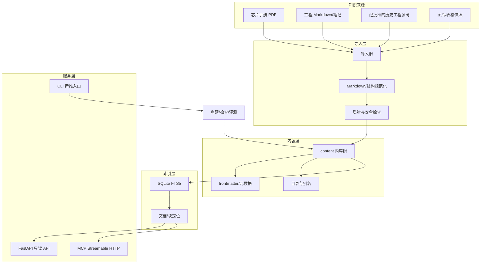

# 架构与组件

> 本文件描述 OWKB 的通用架构，不包含生产实例的地址、凭据或内部数据。

## 1. 总体结构



## 2. 内容层

`content/` 是知识的唯一事实来源，按集合和项目组织：

```text
content/
  芯片手册/            原始规格书转换后的正文与图表
  写法/                协议、外设、实现经验
  项目案例/            真实工程的架构、配置与验证记录
  代码库/              经批准项目的源码只读镜像
  demo/                厂商示例（独立目录）
  00-总览/             规范、索引和编写说明
```

每个 Markdown 文档都有 frontmatter；手册类文档额外带页锚点和图片快照。
内容层不依赖数据库即可阅读和版本管理。

## 3. 索引层

索引使用 SQLite FTS5，主要是可重建的派生数据：

- 文档标题、路径、标签、正文参与检索；
- 标题/路径/标签与正文采用不同权重；
- 索引记录文档块和页/行范围，便于返回可引用位置；
- 索引文件不进入 Git；内容变化后可全量重建；
- 重建失败不影响内容层，修复后可重试。

## 4. 服务层

服务层是只读查询接口：

- **HTTP API**：健康检查、检索、读取文档等；
- **MCP**：面向 agent 的工具接口，通常提供 `search`、`read`、`tree` 等能力；
- **CLI**：管理员导入、重建索引、查询状态、体检、评测。

服务层不提供任意写文件接口；知识更新必须通过受控导入流程。

## 5. 部署形态

OWKB 适合单机部署：

- 静态内容放在本地磁盘；
- SQLite 索引与内容同机；
- 进程监听本机回环地址；
- 由反向代理提供 TLS 和访问控制；
- 定期备份内容、配置和数据库。

对外暴露时应使用：

- 只读接口；
- 强认证；
- 速率限制与审计；
- 不把内部管理接口直接暴露到公网。

## 6. 可观测性

建议至少记录：

- 服务健康与索引构建状态；
- 访问日志（请求路径、状态、调用者）；
- 索引重建/失败日志；
- 内容导入审计；
- 备份与磁盘空间。

日志不应记录 token、证书私钥或完整请求正文。

## 7. 为什么这样拆

- 内容与索引解耦，便于迁移和重建；
- 文档可读性和 agent 检索共用同一份内容；
- 只读服务边界清晰，降低误写风险；
- 单机 SQLite 足够支撑中小规模内部知识库；
- 需要扩展时，可以替换索引或 API 层而不改内容格式。
