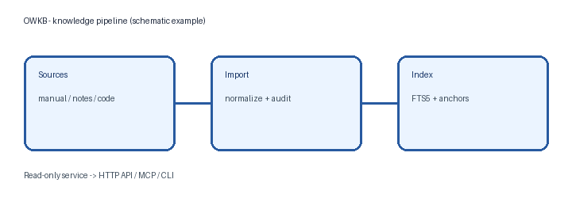

# 示例：带页锚点的手册片段

> 这是脱敏示例，不对应任何真实芯片或产品。

<!-- pdf-page: 12 -->

## 4.3 定时器示例

| 位 | 名称 | 说明 |
|---|---|---|
| 7 | EN | 定时器使能 |
| 6:4 | PS | 预分频选择 |
| 3:0 | CLK | 时钟源选择 |

```text
复位值：0x00
```

### 4.3.1 使用注意

- 修改预分频前先关闭定时器；
- 计数清零后等待一个时钟周期；
- 中断标志需要软件清除。

<!-- pdf-page: 13 -->

## 4.4 示例图



> 图片为占位说明；真实手册导入时应使用 `snapshots/` 下的相对路径。
